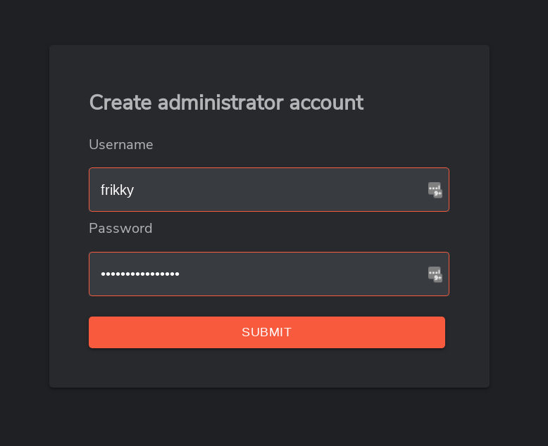

<h1 align="center">

[](https://shuffler.io)

Shuffle Installation

<p align="center">
  <a href="https://console.cloud.google.com/marketplace/product/shuffle-public/shuffle">
    
  </a>
  &nbsp;&nbsp;&nbsp;
  <a href="https://aws.amazon.com/marketplace/pp/prodview-typ7upg6kwntk">
    
  </a>
</p>

</h1>

Installation of Shuffle is currently available for [docker](https://shuffler.io/docs/configuration#production-readiness) and [kubernetes](https://shuffler.io/docs/configuration#Kubernetes). 

- Looking to run workflows onprem, but don't want to run the entire stack? Looks into [Environments & Orborus hosting Onprem](https://shuffler.io/docs/organizations#Environments)
- Looking for how to update Shuffle? Check the [updating guide](https://shuffler.io/docs/configuration#updating_shuffle)

This document outlines an introduction environment which is **not** scalable. [Read here](https://shuffler.io/docs/configuration#production_readiness) for information on production readiness and scalability. This also includes system requirements and configurations for **Docker Swarm** or **Kubernetes**. 


# Docker - *nix
The Docker setup is the default setup, and is ran with docker compose. This is [NOT a scalable build](https://shuffler.io/docs/configuration#production-readiness) without changes.

**PS: if you're setting up Shuffle on Windows, go to the next step (Windows Docker setup)**

1. Make sure you have [Docker](https://docs.docker.com/get-docker/) and [git](https://git-scm.com/downloads)(for downloading) installed, and that you have a minimum of **4Gb of RAM** available. More RAM = better.
2. Download Shuffle
```bash
git clone https://github.com/Shuffle/Shuffle
cd Shuffle
```

3. Fix prerequisites for the Opensearch database (Elasticsearch also works). This requires the `shuffle-database` folder to exist.
```bash
sudo chown -R 1000:1000 shuffle-database  # IF you get an error using 'chown', add the user first with 'sudo useradd opensearch'

sudo swapoff -a                           # Disable swap
```

4. Run docker-compose.
```bash
docker compose up -d
```

5. Recommended for Opensearch to work well
```bash
sudo sysctl -w vm.max_map_count=262144             # https://www.elastic.co/guide/en/elasticsearch/reference/current/vm-max-map-count.html
```

When you're done, go to the [After installation](#after-installation) step below.

## Windows with WSL  
This step is for setting up with Docker on windows from scratch.

1. Make sure you have [Docker](https://docs.docker.com/docker-for-windows/install/) and [docker-compose](https://docs.docker.com/compose/install/) installed. WSL2 may be required.

2. Go to https://github.com/frikky/shuffle/releases and download the latest .zip release (or install git)

3. Unzip the folder and enter it

4. Open the .env file and change the line with "OUTER_HOSTNAME" to contain your IP:

```bash
OUTER_HOSTNAME=YOUR.IP.HERE
```

5. Run docker compose
```bash
docker compose up -d
```

### Configurations (high availability, scale, proxies, default users etc.)
https://shuffler.io/docs/configuration


### After installation 
1. After installation, go to http://localhost:3001 (or your servername - https is on port 3443)
2. Now set up your admin account (username & password). Shuffle doesn't have a default username and password. 
3. Sign in with the same Username & Password! Go to /apps and see if you have any apps yet. If not - you may need to [configure proxies](https://shuffler.io/docs/configuration#production_readiness)
4. Check out https://shuffler.io/docs/configuration as it has a lot of useful information to get started



### Useful info
* Check out [getting started](https://shuffler.io/docs/getting_started)
* The default state of Shuffle is NOT scalable. See [production setup](https://shuffler.io/docs/configuration#production_readiness) for more info
* The server is available on http://localhost:3001 (or your servername)
* Further configurations can be done in docker-compose.yml and .env.
* Default database location is in the same folder: ./shuffle-database

# Local development installation

Local development uses **ReactJS** (Vite) for the frontend and **Golang** for the backend. The quick start below runs the backend and database in Docker and the frontend as a dev server, so you don't need Go installed. If you want to edit the backend itself, see [Advanced: run the pieces natively](#advanced-run-the-pieces-natively).

## Quick start (Docker backend + local frontend)

### 1. Prerequisites

| Tool | Why | Notes |
|------|-----|-------|
| [Git](https://git-scm.com/downloads) | Clone the repo | |
| [Docker](https://docs.docker.com/get-docker/) with Compose v2 | Runs the backend and OpenSearch | Docker must be **running** before you continue (`docker info` should print a "Server" section) |
| [Node.js](https://nodejs.org/en/download/) 20+ and npm | Runs the frontend | `package-lock.json` is committed, so `npm` is the default. `yarn` also works |
| 8 GB+ RAM free | OpenSearch is configured with a 3 GB Java heap | The absolute minimum is 4 GB |

**Windows:** Docker Desktop needs WSL2. If Docker shows `Virtual Machine Platform not enabled` or never reaches "Engine running", open PowerShell **as Administrator**, run the commands below, then **reboot**:
```powershell
dism.exe /online /enable-feature /featurename:VirtualMachinePlatform /all /norestart
dism.exe /online /enable-feature /featurename:Microsoft-Windows-Subsystem-Linux /all /norestart
wsl --update
```

**Linux:** OpenSearch needs a higher memory-map limit and write access to the database folder:
```bash
sudo sysctl -w vm.max_map_count=262144
sudo chown -R 1000:1000 shuffle-database
```

### 2. Start the backend and database

```bash
git clone https://github.com/Shuffle/Shuffle
cd Shuffle
docker compose up -d opensearch backend
```

Name the two services explicitly. A plain `docker compose up -d` also starts the full stack (the bundled frontend container, Orborus and `shuffle-security`), which you don't need for development.

The first start takes a few minutes. The backend logs `connection refused` to OpenSearch while the database boots, and it then builds the app images in the background. Both are normal. Follow progress with `docker logs -f shuffle-backend`.

Check that it works:
```bash
curl http://localhost:5001/api/v1/checkusers
# -> {"success": true, ...}
```
`/api/v1/getinfo` returns `401` until you are logged in. That also means the backend is up.

### 3. Start the frontend

```bash
cd frontend
npm install
npm start
```
Open http://localhost:3000. The dev server proxies `/api` to the backend on `localhost:5001` (see [frontend/vite.config.js](../frontend/vite.config.js)).

### 4. Create your admin account

Shuffle has **no default username or password**. When you open http://localhost:3000 for the first time, you are taken to the login page, where you enter a username and password of your choice (minimum 3 characters). This creates the admin account, and you can then sign in with the same credentials. You don't need to set anything in `.env`.

*Optional:* to pre-create the account instead, set `SHUFFLE_DEFAULT_USERNAME` and `SHUFFLE_DEFAULT_PASSWORD` in [.env](../.env) before starting the backend.

### Ports

| Port | What |
|------|------|
| 3000 | Frontend dev server (`npm start`) |
| 3001 / 3443 | Frontend container from `docker compose up` (HTTP / HTTPS), not needed for development |
| 5001 | Backend REST API |
| 9200 | OpenSearch |

### Running workflows (optional)

Building and editing workflows works with the steps above. To actually **execute** workflows, also start Orborus:
```bash
docker compose up -d orborus
```

### Stopping and resetting

```bash
docker compose stop                 # stop containers, keep your data
docker compose down                 # remove containers, keep your data (stored in ./shuffle-database)
docker compose down -v              # remove containers and volumes
```
To start from scratch, also clear the contents of `shuffle-database/` (keep its `README.md`) while the containers are stopped.

### Troubleshooting

| Symptom | Fix |
|---------|-----|
| `failed to connect to the docker API` or `500 Internal Server Error` from `docker info` | Docker isn't running. Start Docker Desktop. On Windows see the WSL2 note above |
| `port is already allocated` | Something else is using 3000, 5001 or 9200. Stop it, or change `BACKEND_PORT` / `FRONTEND_PORT` in [.env](../.env) |
| OpenSearch container keeps restarting | Not enough memory. Lower `-Xms3072m -Xmx3072m` in `docker-compose.yml`, or give Docker more RAM. On Linux, check `vm.max_map_count` |
| Frontend loads but API calls fail | Check that the backend is up with the `curl` above, and that it's reachable on `localhost:5001` |
| Apps list is empty | The backend is still downloading and building apps. Wait a few minutes, and check `docker logs shuffle-backend`. Behind a proxy, set `HTTP_PROXY` / `HTTPS_PROXY` in [.env](../.env) |

**Want to run the Go backend natively instead?** See [Advanced: run the pieces natively](#advanced-run-the-pieces-natively) below. Stop the backend container first (`docker compose stop backend`), keep OpenSearch running, and note that you will need Go installed.

## Advanced: run the pieces natively

Use this if you want to edit and debug a component directly. **You have to stop the matching Docker container first** (for example `docker compose stop backend`). Keep OpenSearch running in Docker.


### Frontend - ReactJS /w cytoscape
http://localhost:3000 - Requires [npm](https://nodejs.org/en/download/)/[yarn](https://yarnpkg.com/lang/en/docs/install/#debian-stable)/your preferred manager. Runs independently from backend.
```bash
cd frontend
npm install   # or: yarn install
npm start     # or: yarn start
```

### Backend - Golang
http://localhost:5001 - REST API - requires [>=go1.13](https://golang.org/dl/)
```bash
export SHUFFLE_OPENSEARCH_URL="https://localhost:9200"
export SHUFFLE_ELASTIC=true
export SHUFFLE_OPENSEARCH_USERNAME=admin
export SHUFFLE_OPENSEARCH_PASSWORD=StrongShufflePassword321!
export SHUFFLE_OPENSEARCH_SKIPSSL_VERIFY=true
cd backend/go-app
go run main.go walkoff.go docker.go
```
**WINDOWS USERS:** Follow [this guide](https://www.wikihow.com/Create-an-Environment-Variable-in-Windows-10) to add environment variables in your machine.

Large portions of the backend is written in another repository - [shuffle-shared](https://github.com/frikky/shuffle-shared). If you want to update any of this code and test in realtime, we recommend following these steps:
1. Clone shuffle-shared to a local repository
2. Open the Shuffle backend's go.mod file (./shuffle/backend/go.mod)  (**NOT** in shuffle-shared)
3. Change the following line to point to your directory AFTER the =>
```
//replace github.com/frikky/shuffle-shared => ../../shuffle-shared
```
4. Make the changes you want, then restart the backend server!
5. With your changes made, make a pull request :fire:

### Database - Opensearch 
Make sure this is running through the docker-compose, and that the backend points to it with SHUFFLE_OPENSEARCH_URL defined.

What it means:
1. Make sure you have docker compose installed
2. Make sure you have the docker-compose.yml file from this repository
3. Run `docker-compose up opensearch -d`

### Orborus
Execution of Workflows:
PS: This requires some specific environment variables
```
cd functions/onprem/orborus
go run orborus.go
```

Environments (modify for Windows):
```
export ORG_ID=Shuffle
export ENVIRONMENT_NAME=Shuffle
export BASE_URL=http://YOUR-IP:5001
export DOCKER_API_VERSION=1.40
```

AND THAT's it - hopefully it worked. If it didn't please email [frikky@shuffler.io](mailto:frikky@shuffler.io)
