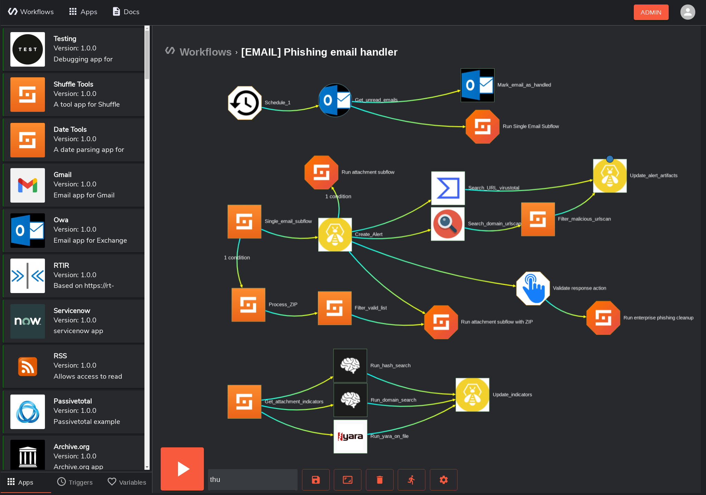
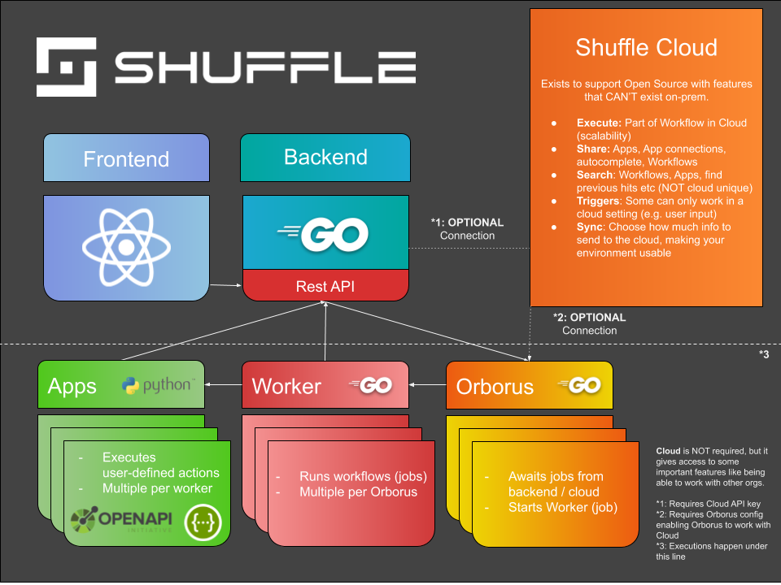

<h1 align="center">

[](https://shuffler.io)

Shuffle Automation

</h1><h4 align="center">
  
  <p>Deploy On<p/>
<p align="center">
  <a href="https://console.cloud.google.com/marketplace/product/shuffle-public/shuffle">
    
  </a>
  &nbsp;&nbsp;&nbsp;
  <a href="https://aws.amazon.com/marketplace/pp/prodview-typ7upg6kwntk">
    
  </a>
</p>


[Shuffle](https://shuffler.io) is an open source automation platform, built for and by the security professionals. Security operations is complex, but it doesn't have to be. Built to work well with MSSP's and other service providers in mind.

[_Key Features_](https://shuffler.io/docs/features) —
[_Community & Support_](https://discord.gg/B2CBzUm) —
[ Get training ](https://shuffler.io/training) -
[_Documentation_](https://shuffler.io/docs) —
[_Getting Started_](https://shuffler.io/docs/getting_started) —
[_Development_](https://github.com/shuffle/Shuffle/blob/main/.github/CONTRIBUTING.md) -
[ Set up a demo call ](https://shuffler.io/contact)

Follow us on Twitter at [@shuffleio](https://twitter.com/shuffleio).


</h4>



## Try it
* Self-hosted: Check out the [installation guide](https://github.com/shuffle/shuffle/blob/main/.github/install-guide.md)
* Local development: see the [local development quick start](.github/install-guide.md#local-development-installation)
* Cloud: Register at https://shuffler.io/register and get cooking

Please consider [sponsoring](https://github.com/sponsors/frikky) the project if you want to see more rapid development.

## Local development

The [local development quick start](.github/install-guide.md#local-development-installation) in the install guide covers prerequisites (including the Windows/WSL2 setup), starting the backend and database with Docker, running the frontend, creating your admin account, ports and troubleshooting.

```bash
docker compose up -d opensearch backend   # backend + database
cd frontend && npm install && npm start     # frontend on http://localhost:3000
```

## Support
* [Discord](https://discord.gg/B2CBzUm)
* [Twitter](https://twitter.com/shuffleio)
* [Email](mailto:frikky@shuffler.io)
* [Open issue](https://github.com/shuffle/Shuffle/issues/new)
* [Shuffler.io](https://shuffler.io/contact)

## Blogposts
* [1. Introducing Shuffle](https://medium.com/security-operation-capybara/introducing-shuffle-an-open-source-soar-platform-part-1-58a529de7d12)
* [2. Getting started with Shuffle](https://medium.com/security-operation-capybara/getting-started-with-shuffle-an-open-source-soar-platform-part-2-1d7c67a64244)
* [3. Integrating Shuffle with Virustotal and TheHive](https://medium.com/@Frikkylikeme/integrating-shuffle-with-virustotal-and-thehive-open-source-soar-part-3-8e2e0d3396a9)
* [4. Real-time executions with TheHive, Cortex and MISP](https://medium.com/@Frikkylikeme/indicators-and-webhooks-with-thehive-cortex-and-misp-open-source-soar-part-4-f70cde942e59)

## Documentation
[Documentation](https://shuffler.io/docs) can be found on [https://shuffler.io/docs](https://shuffler.io/docs) and is written here: [https://github.com/shuffle/shuffle-docs](https://github.com/shuffle/shuffle-docs).

## Related repositories
* OpenAPI apps: [https://github.com/shuffle/security-openapis](https://github.com/shuffle/security-openapis)
* Documentation: [https://github.com/shuffle/shuffle-docs](https://github.com/shuffle/shuffle-docs)
* Workflows: [https://github.com/shuffle/shuffle-workflows](https://github.com/shuffle/shuffle-workflows)
* Python apps: [https://github.com/shuffle/shuffle-apps](https://github.com/shuffle/python-apps)

## Features
* Simple, feature rich [workflow editor](https://shuffler.io/docs/workflows)
* App creator using [OpenAPI](https://github.com/shuffle/OpenAPI-security-definitions)
* Premade apps for your security tools
* Organization and sub-organization control
* Hybrid resource sharing with shuffler.io (optional)

## Website
[https://shuffler.io](https://shuffler.io)

## Contributing
We want to make the world of cybersecurity more accessible and need all the help we can get. Send an email to [support@shuffler.io](mailto:support@shuffler.io) and we'll make sure to give you any training you may need.

These are the main areas to contribute in:
* Frontend (ReactJS)
* Backend (Golang)
* App Creation (Python & GUI w/OpenAPI)
* Documentation (Markdown)
* Workflow creation (GUI & Conceptualizing) 
* Content Creation (Blogs, videos etc) 

Contributing guidelines are outlined [here](https://github.com/shuffle/Shuffle/blob/main/.github/CONTRIBUTING.md).

## Contributors 


**Shuffle**
<a href="https://github.com/shuffle/shuffle/graphs/contributors">
  
</a>

[**App magicians**](https://github.com/shuffle/shuffle-apps)
<a href="https://github.com/shuffle/shuffle-apps/graphs/contributors">
  
</a>


## License
All modular information related to Shuffle will be under MIT (anyone can use it for whatever purpose), with Shuffle itself using AGPLv3. 

Workflows: MIT
Documentation: MIT
Shuffle backend: AGPLv3 
Apps, specification and App SDK: MIT

## Architecture


## Security Contributors: Hall of Fame
[Pushpraj](https://github.com/PushprajPatil) - Reported several issues between July and August 2024

### Repository overview 
Below is the folder structure with a short explanation
```bash
├── README.md				# What you're reading right now
├── backend					# Contains backend related code.
│   ├── go-app 			# The backend golang webserver
│   └── app_sdk			# The SDK used for apps
├── frontend				# Contains frontend code. ReactJS (Vite), Material UI and cytoscape
├── functions				# Has execution and extension resources, such as the Wazuh integration
│   ├── onprem				# Code for onprem solutions
│   │   ├── Orborus 	# Distributes execution locations
│   │   ├── Worker		# Runs a workflow
├── shuffle-apps			# Local app folder (mounted into the backend container)
├── shuffle-database		# OpenSearch data (created/used by docker compose)
├── .env					# Configuration used by docker-compose.yml
└── docker-compose.yml 	# Used for deployments
```

[Get in touch](https://shuffler.io/contact), send a mail to [frikky@shuffler.io](mailto:frikky@shuffler.io) or poke me on twitter [@frikkylikeme](https://twitter.com/frikkylikeme)
